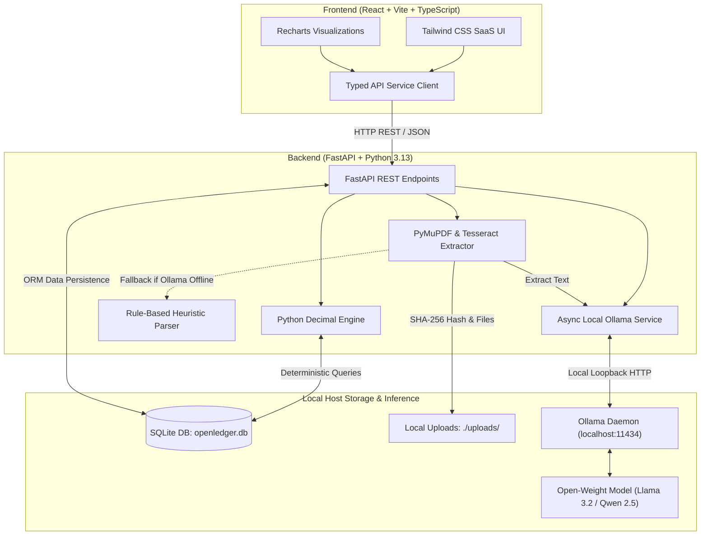

# OpenLedger AI — Your Private AI Finance Assistant

> **Privacy-First, Open-Weight AI Finance Assistant for Freelancers, Independent Contractors & Side Hustles.**  
> Extract invoices & receipts, manage expenses with 100% mathematical precision, and query your finances locally with zero cloud telemetry.

---

## 1. Project Overview

**OpenLedger AI** is a production-grade, local-first financial productivity application built for the **Open-Source AI Building Challenge** under the theme **"Side Hustle"**.

Modern cloud-based bookkeeping and invoice parsing tools (e.g., Expensify, QuickBooks, proprietary cloud LLM plugins) suffer from two major flaws for independent side-hustlers:
1. **Recurring API and subscription taxes:** Cloud AI services bill per token, charging \$0.02–\$0.06 per document scan. Over hundreds of monthly receipts, this drains side-hustle profit margins.
2. **Confidential data leakage:** Financial receipts, tax IDs, vendor relationships, and client invoices are transmitted across public networks and stored on multi-tenant servers.

**OpenLedger AI** solves this by uniting **local open-weight instruction models (via Ollama)**, **deterministic Python Decimal arithmetic**, **PyMuPDF**, and **SQLite** into a fast, private desktop web experience that runs 100% on your machine.

---

## 2. Problem Statement

* **Manual expense data entry is tedious**: Freelancers spend 5–10 hours a month manually entering vendor names, line items, and tax amounts.
* **Closed AI APIs are expensive & locked**: Proprietary closed models (OpenAI, Claude, Gemini) create vendor lock-in, impose unpredictable rate limits, and charge recurring fees.
* **Hallucination risks in finance**: Language models are probabilistic and notorious for hallucinating arithmetic totals. An accounting tool cannot tolerate arithmetic errors.
* **Privacy vulnerabilities**: Invoices reveal proprietary client details, pricing rates, and home addresses that should never train public LLMs.

---

## 3. Target Users

* **Freelancers & Solopreneurs**: Web developers, graphic designers, writers, and digital consultants managing multiple client invoices.
* **Side Hustlers**: Professionals building micro-SaaS, e-commerce stores, or consulting practices on nights and weekends.
* **Independent Contractors**: 1099 contractors needing itemized records for tax-deductible business expenses.
* **Privacy-Conscious Individuals**: Students and privacy advocates who refuse to send bank statements or receipts to third-party tracking services.

---

## 4. Key Features

- **Local Optical Document Extraction**: Drag-and-drop PDF invoices and image receipts (PNG, JPG). Fast text extraction via **PyMuPDF** and **Tesseract OCR**.
- **Open-Weight Structured Parsing**: Extracts vendor, invoice number, issue date, due date, subtotal, tax, total, payment status, category, and line items into strict JSON.
- **Deterministic Math Engine**: All computations (subtotals, tax sums, cash flow, month-over-month trends) are executed in Python using the `decimal.Decimal` module—**never** language model guesses.
- **Cryptographic Duplicate Detection**: Computes SHA-256 hashes on upload to instantly flag duplicate receipts before they create duplicate expenses.
- **Local AI Finance Assistant Workspace**: Conversational query workspace grounded in verified SQLite records. Answers questions like *"How much did I spend on software this quarter?"* and *"Which invoices are still unpaid?"*.
- **Interactive Financial Visualizations**: Clean Recharts graphs displaying 6-month cash flow trends, category distribution donuts, and top vendor rankings.
- **Transparent Privacy & One-Click Purge**: Complete audit log of local operations, zero network telemetry, and guaranteed Right to Erasure with a one-click local storage purge.
- **Export & Reporting**: RFC 4180 CSV exports for transactions and invoices, plus a clean printable HTML summary report.
- **Demo Data Sandbox**: If the database is empty, users can explore realistic records with a single click without fabricating sample numbers as real data.

---

## 5. Architecture



---

## 6. Technology Stack

### Frontend
* **React 18** with **TypeScript**
* **Vite** for sub-second hot module reloading and optimized builds
* **Tailwind CSS** for modern fintech typography and clean components
* **Lucide React** for consistent icons
* **Recharts** for responsive financial area charts, bar graphs, and donut charts
* **React Router v7** for deep-link navigation

### Backend
* **Python 3.13**
* **FastAPI** for high-performance async API endpoints and automatic OpenAPI docs
* **Pydantic v2 & Pydantic-Settings** for strict schema validation
* **SQLAlchemy 2.0** ORM for relational queries
* **SQLite** for zero-configuration, single-file local persistence
* **Python `decimal` module** for exact, non-floating-point financial accounting

### Document Processing
* **PyMuPDF (`pymupdf`)** for fast text extraction from PDF invoices
* **Pillow (`PIL`) & Tesseract OCR (`pytesseract`)** for receipt images
* **SHA-256 Cryptographic Hashing** for duplicate file identification

### AI & Inference
* **Ollama** running locally on `http://127.0.0.1:11434`
* Open-weight models supported: **Llama 3.2 (1B/3B)**, **Qwen 2.5 (3B/7B)**, **Mistral (7B)**, **Phi-3**
* **Structured JSON Mode**: Enforces schema adherence for extracted line items and metrics
* **Deterministic Heuristic Fallback**: Active when Ollama is offline so users are never blocked

---

## 7. How the Open-Weight Model is Used

1. **Document Structure Extraction**: When an invoice PDF or receipt image is uploaded, PyMuPDF extracts raw text. The text is passed to Ollama with a system prompt instructing the model to output valid JSON matching our Pydantic schema (`vendor`, `invoice_number`, `dates`, `subtotal`, `tax`, `total_amount`, `category`, `line_items`).
2. **Grounded Financial Answering**: In the AI Assistant workspace, the backend first queries SQLite and runs deterministic Python Decimal math (calculating exact totals, month-over-month deltas, unpaid invoice counts). These verified factual metrics are injected into the model prompt as ground truth. The open-weight model handles language synthesis and executive advice without inventing numbers.
3. **Privacy Isolation**: No document text or prompts ever leave `localhost`.

---

## 8. Why Open Innovation Matters

* **Community-Audited Safety**: Open-weight weights can be inspected and run in isolated air-gapped environments without surprise terms-of-service revisions.
* **Durability**: If an external AI company shuts down, changes pricing, or censors financial workflows, OpenLedger AI continues functioning indefinitely.
* **Democratization of Enterprise AI**: Independent contractors gain access to automated document intelligence previously reserved for large enterprises paying tens of thousands of dollars to proprietary software vendors.

---

## 9. Privacy Benefits

* **No Remote Telemetry**: Zero Google Analytics, cookies, or remote beacon pixels.
* **No Cloud API Transmissions**: No API keys from OpenAI, Anthropic, or Google Cloud are used.
* **Zero Cross-Company Training**: Your financial records are never ingested to train public foundation models.
* **True Data Sovereignty**: All files reside in your local `./uploads` directory and SQLite file.

---

## 10. Cost and Vendor-Lock-in Advantages

| Dimension | Proprietary SaaS (Expensify / Cloud LLMs) | OpenLedger AI (Local Open-Weight) |
| :--- | :--- | :--- |
| **Per-Document Cost** | \$0.02 – \$0.05 per receipt scan | **\$0.00** (Uses hardware you own) |
| **Monthly Subscription** | \$15 – \$50 / user / month | **Free & Open-Source** (Optional SaaS support) |
| **Data Location** | Remote multi-tenant servers | **Local SQLite on your machine** |
| **Offline Support** | Zero (Requires active internet connection) | **100% Offline Capable** once installed |
| **Model Portability** | Locked to proprietary provider | **Swap any Ollama model** (Llama 3.2, Qwen, Mistral) |

---

## 11. Hardware Requirements

* **Operating System**: Windows 10/11 (64-bit), macOS, or Linux.
* **CPU**: Modern quad-core x86_64 or ARM64 processor.
* **RAM**:
  * Minimum: 8 GB RAM (runs Llama 3.2 1B/3B or Qwen 2.5 3B smoothly on CPU).
  * Recommended: 16 GB RAM or 6GB+ VRAM (NVIDIA GPU or Apple Silicon).
* **Storage**: ~500 MB for application + ~2.0 GB for Llama 3.2 model weights.

---

## 12. Windows Installation Instructions (PowerShell)

### Prerequisites
Make sure **Python 3.11+**, **Node.js 18+**, and **git** are installed.

```powershell
# Verify runtimes
python --version
node --version
npm --version
```

### Step 1: Clone and Set Up Backend

```powershell
# Navigate to project folder
cd c:\Users\Harshini\Downloads\OpenLedger

# Create Python virtual environment
python -m venv venv

# Activate virtual environment
.\venv\Scripts\Activate.ps1

# Install backend dependencies
pip install -r backend/requirements.txt
```

### Step 2: Set Up Frontend

```powershell
# Navigate to frontend folder
cd frontend

# Install npm dependencies
npm install

# Return to root directory
cd ..
```

---

## 13. Ollama Installation and Model Setup

1. Download and install Ollama for Windows from [https://ollama.com/download](https://ollama.com/download).
2. Open a new PowerShell window and pull the recommended open-weight model:

```powershell
# Recommended default model (Fast, highly accurate on JSON schemas, ~2.0 GB)
ollama run llama3.2

# Alternatively, for higher reasoning capacity:
ollama run qwen2.5:7b
# or
ollama run mistral
```

3. Confirm Ollama is running locally:
```powershell
curl http://127.0.0.1:11434/api/tags
```

> **Note:** If Ollama is not installed or offline, OpenLedger AI **automatically switches to its built-in rule-based extractor and deterministic calculation engine**, so you can use and evaluate the application immediately!

---

## 14. Starting the Application

Open two PowerShell windows:

### Terminal 1: Backend (FastAPI)
```powershell
cd c:\Users\Harshini\Downloads\OpenLedger
.\venv\Scripts\Activate.ps1
cd backend
python -m uvicorn app.main:app --host 127.0.0.1 --port 8000 --reload
```
*Backend API will be live at: [http://127.0.0.1:8000](http://127.0.0.1:8000)*  
*Interactive Swagger Documentation: [http://127.0.0.1:8000/docs](http://127.0.0.1:8000/docs)*

### Terminal 2: Frontend (React + Vite)
```powershell
cd c:\Users\Harshini\Downloads\OpenLedger\frontend
npm run dev
```
*Open your browser and navigate to: [http://localhost:5173](http://localhost:5173)*

---

## 15. Running Automated Tests

Run the complete test suite (18 automated tests covering Decimal arithmetic, document parsing, duplicate detection, transaction CRUD, and AI offline fallbacks):

```powershell
cd c:\Users\Harshini\Downloads\OpenLedger\backend
..\venv\Scripts\python -m pytest -v
```

To run frontend build checks:
```powershell
cd c:\Users\Harshini\Downloads\OpenLedger\frontend
npm run build
```

---

## 16. Limitations & Honest Assessment

Where this local open-source approach excels:
* **Cost**: $0 ongoing API fees for recurring invoice scans.
* **Privacy**: Impossible for confidential data to leak outside localhost.
* **Reliability**: No cloud outages, rate limits, or unexpected API deprecations.

Where closed APIs or dedicated enterprise cloud services might perform better:
* **Severely degraded physical receipts**: Extremely blurry, crumpled receipts with faint thermal ink often require multi-billion parameter cloud vision models or specialized cloud OCR pipelines.
* **Hardware constraints**: Devices with less than 8GB RAM may experience slower inference on 7B+ parameter models.

---

## 17. Future Improvements

* Multi-page batch OCR queuing for high-volume receipt processing.
* Native receipt camera capture from mobile web browsers.
* Direct integration with local open-source accounting standards (e.g. Beancount / Plain Text Accounting).
* Automated bank statement QIF / OFX reconciliations.

---

## 18. Side-Hustle Business Model

OpenLedger AI is structured for commercialization as an open-core SaaS application:

* **Starter (\$9/mo illustrative)**: 30 monthly documents, basic expense tracking, CSV export.
* **Freelancer (\$19/mo illustrative)**: 150 monthly documents, automated duplicate detection, AI assistant, monthly financial reports.
* **Small Business (\$39/mo illustrative)**: Unlimited documents, multi-currency conversion, custom prompt profiles, priority support.

---

## 19. Model Licensing & Attribution

* **Meta Llama 3.2**: Distributed under the [Llama 3.2 Community License Agreement](https://github.com/meta-llama/llama-models/blob/main/models/llama3_2/LICENSE). Built by Meta AI.
* **Qwen 2.5**: Developed by the Qwen Team, Alibaba Cloud, under the Apache 2.0 License.
* **Mistral 7B**: Developed by Mistral AI, licensed under the Apache 2.0 License.
* **OpenLedger AI**: Licensed under the MIT License.
